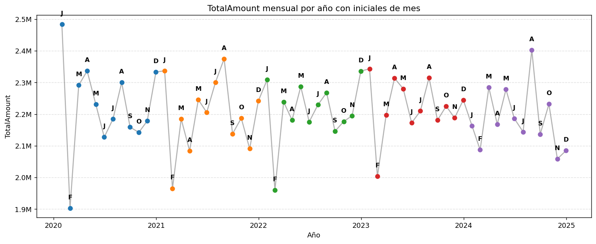
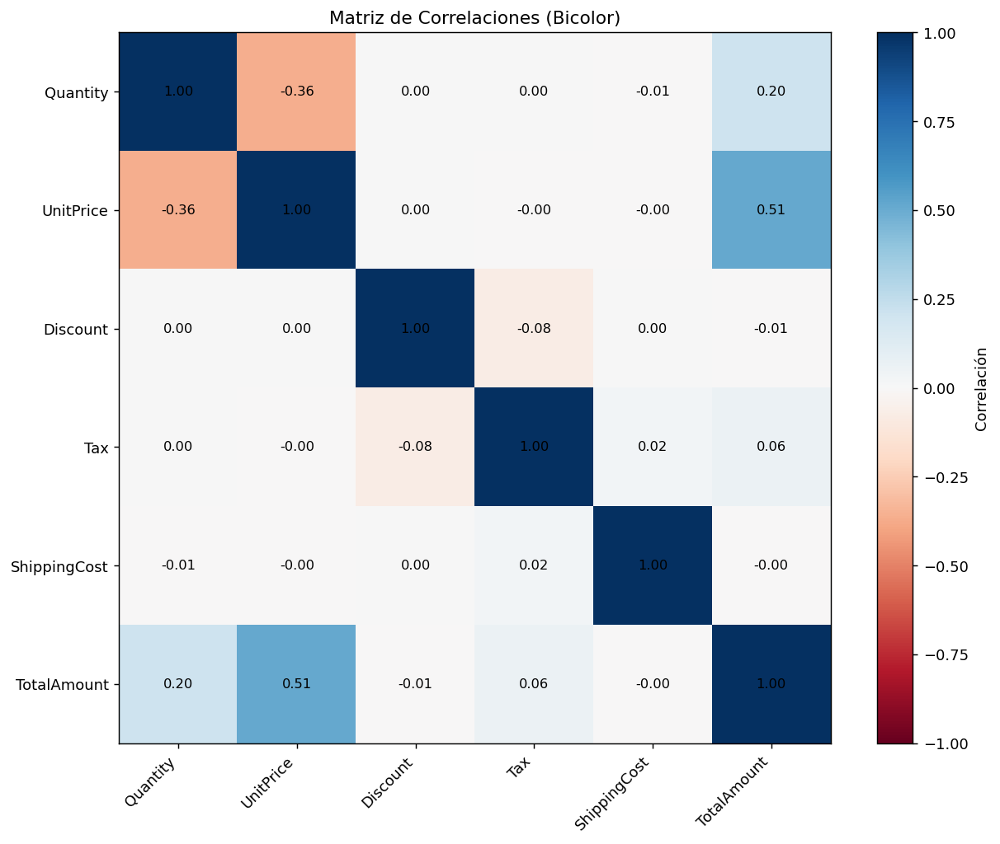
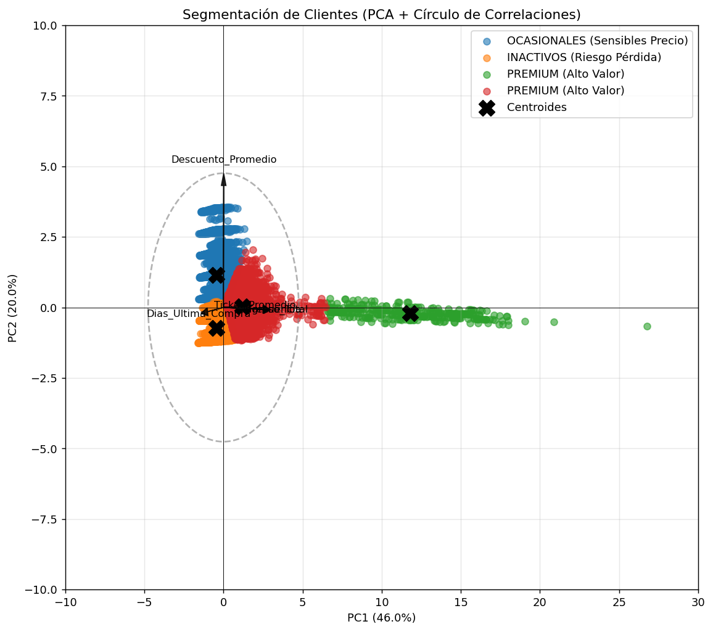
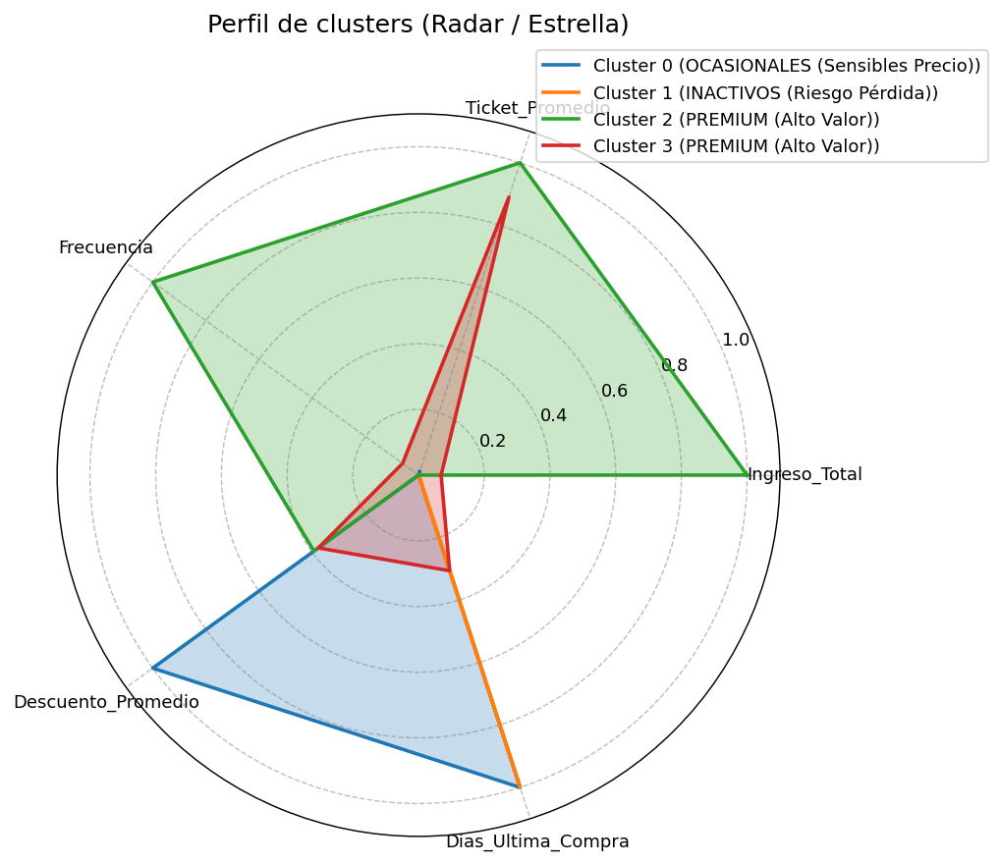
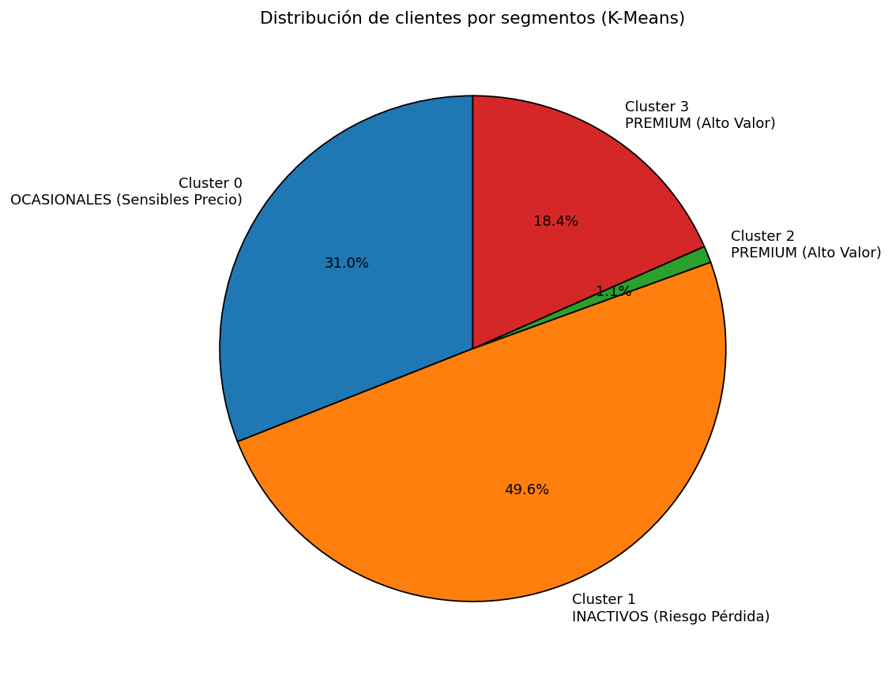

# Amazon Sales Data Analysis

A modular Python project for exploratory data analysis (EDA), visualization, and automatic customer segmentation of Amazon sales data using a machine learning pipeline based on PCA and K-Means clustering.

[](https://opensource.org/licenses/MIT)
[](https://www.python.org/)
[](https://peps.python.org/pep-0008/)

## Overview

The project turns a raw sales CSV into business insight through a layered, reusable architecture:

- **Data pipeline** - load, clean, and prepare the dataset
- **Exploratory analysis** - descriptive statistics and top/bottom rankings
- **Visualization** - distributions, time series, correlations, and segmentation plots
- **Customer segmentation (ML)** - a reproducible machine learning workflow that groups customers into actionable segments using dimensionality reduction (PCA) and K-Means clustering

## Core Features

- Duplicate removal, date parsing, and handling of irrelevant or missing columns
- Numeric and categorical descriptive statistics
- Top/bottom analysis by product, category, customer, state, and seller
- Monthly revenue time series analysis
- Correlation matrix and bivariate scatter plot matrix
- Customer behavioral profiling (similar to RFM)
- PCA for dimensionality reduction
- K-Means clustering with the elbow method and inertia analysis
- Automatic segment interpretation based on relative cluster profiles

## The Machine Learning Pipeline

The segmentation workflow in `src/clustering/` is fully reproducible and configuration-driven:

```
Clean data
    -> Aggregate per customer (TotalAmount, Ticket, Frequency, Discount, Recency)
    -> StandardScaler (center and scale)
    -> PCA dimensionality reduction (default: 2 components)
    -> K-Means clustering (configurable k, k-means++, multiple init)
    -> Relative cluster profile (vs. global average)
    -> Automatic segment labeling
```

### Segment Labels

After clustering, each group is automatically labeled depending on its relative profile:

| Segment | Profile |
|---|---|
| Premium (High Value) | High income, high frequency, recent purchase |
| Frequent (Loyal) | Above-average purchase frequency |
| Occasional (Price Sensitive) | High average discount ratio |
| Inactive (At Risk) | Long time since last purchase |

Cluster validation is supported through the elbow method, total inertia decomposition (intra/inter-class), and PCA loadings with a correlation circle.

## Results & Conclusions

The figures below are produced by a full run of `python main.py` over the included `amazon.csv`. A machine-readable copy of the same summary is available in `docs/conclusions_summary.json`.

### Dataset snapshot

| Metric | Value |
|---|---|
| Records | 100,000 |
| Columns | 20 |
| Unique customers | 30,243 |
| Unique products | 175 |
| Total revenue | USD 132,424,396.57 |
| Average ticket | USD 1,324.24 |
| Variance explained by PC1 + PC2 | 66.0% |

### Ranking highlights

| Metric | Top result |
|---|---|
| Best-selling product (units) | Outdoor Solar Lights - 18,713 units (USD 889,654.94) |
| Highest-revenue product | Gaming Laptop RTX - USD 3,405,320.61 |
| Highest-value customer | CUST034975 (James Hart) - USD 374,834.83 |
| Peak monthly revenue | 2020-01 - USD 2,483,534.88 |

### Customer segments (K-Means, k = 4)

| Cluster | Label | Customers | Revenue share | Avg income | Avg ticket | Frequency | Discount |
|---|---|---|---|---|---|---|---|
| 0 | Occasional (Price Sensitive) | 9,375 (31.0%) | 9.7% | USD 1,375.50 | USD 731.53 | 1.78 | 15% |
| 1 | Inactive (At Risk) | 14,987 (49.6%) | 15.3% | USD 1,355.48 | USD 717.02 | 1.80 | 3% |
| 2 | Premium (High Value) | 322 (1.1%) | 31.9% | USD 131,117.38 | USD 1,836.12 | 71.62 | 7% |
| 3 | Premium (High Value) | 5,559 (18.4%) | 43.0% | USD 10,252.70 | USD 1,712.97 | 5.99 | 7% |

### Conclusions

- Revenue is highly concentrated: the ~19.5% of customers in clusters 2 and 3 generate roughly 75% of total revenue.
- The smallest cluster (1.1% of customers) is the highest-value group, with an average income about 95x higher and a purchase frequency about 40x higher than the mass market.
- Approximately 80% of customers are low-frequency and low-spend (clusters 0 and 1); they represent the main retention and reactivation opportunity.
- Two clusters received the same automatic label (Premium (High Value)); the labeling thresholds separate them only by income magnitude, which is a natural candidate for refinement.

## Example Output

The following figures are produced directly by the pipeline and stored under `docs/images/`:

| | |
|---|---|
|  |  |
| *Monthly revenue over time.* | *Correlation matrix of numeric variables.* |
|  |  |
| *Customer segments projected on PC1/PC2 with the loading circle.* | *Behavioral profile of each segment (radar).* |
|  | |
| *Share of records and customers per segment (pie charts).* | |

## Getting Started

### Prerequisites

- Python 3.8 or later
- `pip`

### Installation

```bash
git clone <repository-url>
cd analisis-de-datos

python -m venv venv
venv\Scripts\activate      # Windows
source venv/bin/activate   # Linux / macOS

pip install -r requirements.txt
```

### Usage

Run the complete analysis pipeline (data loading, cleaning, EDA, visualizations, and segmentation):

```bash
python main.py
```

`main.py` also exposes reusable entry points for testing and partial pipelines:

- `run_full_analysis()` - the entire workflow
- `run_data_loading_only()` - load and inspect the dataset
- `run_visualization_only(df)` - distribution and time series plots
- `run_segmentation_only(df, original_df)` - complete segmentation only

### Running Tests

```bash
pytest tests/
```

### Jupyter Notebooks

An interactive implementation of the pipeline is available:

```bash
jupyter notebook notebooks/analisis_exploratorio.ipynb
```

## Project Structure

The repository follows a layered architecture, where each layer has the single responsibility:

```
analisis-de-datos/
├── main.py                 # Entry point and pipeline orchestration
├── amazon.csv              # Dataset used for the analysis
├── requirements.txt        # Python dependencies
├── LICENSE                 # MIT license
├── README.md
├── src/
│   ├── config/             # Centralized configuration (columns, models, plot styling)
│   ├── core/               # Formatters and display helpers
│   ├── data/               # DataLoader and DataCleaner
│   ├── analysis/           # EDA and statistical analyzer
│   ├── visualization/      # Distribution and chart plotter
│   ├── clustering/         # PCAModel, KMeansModel, CustomerSegmenter
│   └── reports/            # Summary report generator
├── tests/                  # pytest test suite
├── notebooks/              # Jupyter notebooks
└── docs/wiki/              # Project documentation
```

### Layer Reference

| Directory | Responsibility |
|---|---|
| `src/config/` | Centralized settings: columns, data types, clustering params, plot styling |
| `src/core/` | Number/currency formatters and environment configuration |
| `src/data/` | `DataLoader` (CSV ingestion with typed dtypes) and `DataCleaner` |
| `src/analysis/` | `ExploratoryDataAnalysis` and `StatisticalAnalyzer` |
| `src/visualization/` | `DistributionPlotter` and `ChartPlotter` |
| `src/clustering/` | `PCAModel`, `KMeansModel`, and the `CustomerSegmenter` pipeline |
| `src/reports/` | `ReportGenerator` for console-readable summaries |

## Configuration

All knobs are centralized in `src/config/settings.py`:

| Setting | Purpose |
|---|---|
| `DATASET`, `DTYPES` | Source CSV path and column data types |
| `COLS_TO_DROP` | Columns removed during cleaning |
| `NUMERIC_VARS`, `CATEGORICAL_VARS` | Variables used in distribution analysis |
| `ID_VARS` | Identity columns for top/bottom analysis |
| `CLUSTERING_VARS` | Behavioral features feed into the clustering pipeline |
| `KMEANS_CONFIG`, `PCA_CONFIG` | Model hyperparameters (k, initialization, random state) |
| `PLOT_STYLE`, `FIGURE_SIZES` | Global plot styling |

## Documentation

Extended guide and module reference are available in `docs/wiki/Home.md`.

## License

This project is licensed under the MIT License. See the [LICENSE](LICENSE) file for details.

## Author

Mateo Cobo